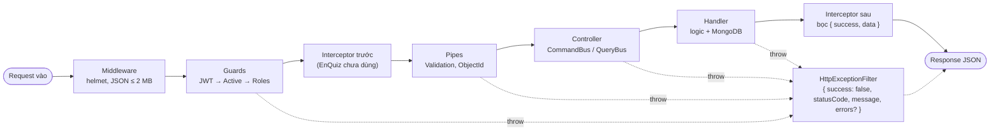
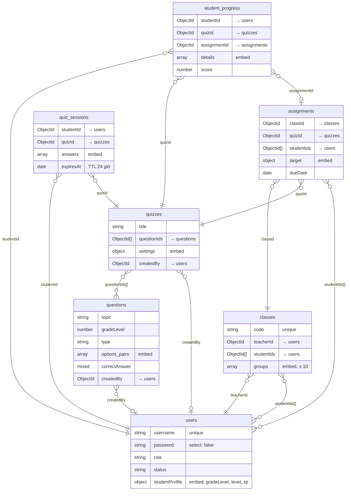

# Khóa học thực chiến NestJS & MongoDB (dựa trên src/be EnQuiz)

Nov 18, 2026 · @Duck

## Giới thiệu khóa học

Khóa học này dạy NestJS và MongoDB qua chính backend EnQuiz (thư mục `be/`): mỗi khái niệm lý thuyết đi kèm một đoạn code thật trong dự án, rồi một bài tập để tự làm.

**Mục tiêu sau khóa học**, học viên có thể:

1. Giải thích được kiến trúc module + Dependency Injection của NestJS và tự tạo một module mới.
2. Theo dõi một request đi qua Guard → Pipe → Controller → Handler → Interceptor/Filter.
3. Thiết kế schema MongoDB (embed hay reference, index) và viết schema Mongoose.
4. Viết truy vấn, phân trang, aggregation và hiểu khi nào cần transaction.
5. Áp dụng JWT + phân quyền theo role, CQRS và viết unit/e2e test.

**Đối tượng:** lập trình viên đã biết JavaScript/TypeScript cơ bản (class, async/await, decorator ở mức đọc hiểu), chưa cần biết NestJS hay MongoDB.

**Công nghệ trong dự án** (theo `be/package.json`):

| Thành phần | Thư viện | Vai trò |
| --- | --- | --- |
| Framework | `@nestjs/core`, `@nestjs/common` v12 | Khung ứng dụng, DI, routing |
| HTTP | `@nestjs/platform-express`, `helmet` | Server Express + header bảo mật |
| Database | `mongoose` v9, `@nestjs/mongoose` | ODM cho MongoDB |
| Kiến trúc | `@nestjs/cqrs` | Command / Query / Event |
| Xác thực | `@nestjs/passport`, `passport-jwt`, `@nestjs/jwt`, `bcryptjs` | Đăng nhập, JWT, băm mật khẩu |
| Validation | `class-validator`, `class-transformer` | Kiểm tra DTO |
| Cấu hình | `@nestjs/config`, `@nestjs/throttler` | Biến môi trường, chống brute-force |
| Test | `vitest`, `supertest`, `mongodb-memory-server` | Unit test, e2e với DB trong RAM |

**Cách học:** mở song song tài liệu này và VS Code tại `be/src`. Mỗi module có phần *Lý thuyết*, *Trong EnQuiz* (đường dẫn file thật) và *Tự làm*. Lộ trình gợi ý: 8 buổi, mỗi buổi 2–3 giờ, theo đúng thứ tự Module 1 → 8.

Lưu ý: dự án dùng ESM (`"type": "module"`), nên import tương đối luôn kết thúc bằng `.js` (ví dụ `import { AppModule } from './app.module.js'`) dù file nguồn là `.ts`.

## Module 1 — Kiến trúc backend EnQuiz và cách chạy dự án

Backend EnQuiz là một REST API NestJS, chia theo **feature module** (mỗi nghiệp vụ một thư mục), dùng **CQRS** bên trong mỗi module và MongoDB qua Mongoose. Mọi endpoint nằm dưới tiền tố `/api/v1`.

### 1.1 Cấu trúc thư mục

```
be/src/
├── main.ts                  # điểm khởi động: tạo app, helmet, CORS, listen
├── app.module.ts            # root module: import mọi module + guard toàn cục
├── common/                  # dùng chung: decorators, guards, pipes, filters, interceptors, utils
├── config/env.validation.ts # kiểm tra biến môi trường lúc khởi động
├── database/                # kết nối MongoDB, seed dữ liệu demo
└── modules/
    ├── auth/        # đăng ký, đăng nhập, JWT
    ├── users/       # hồ sơ, quản trị tài khoản
    ├── questions/   # ngân hàng câu hỏi, import CSV
    ├── quizzes/     # bài quiz, bản đồ trạm
    ├── progress/    # phiên chơi, chấm điểm, XP, bảng xếp hạng
    ├── classes/     # lớp học, nhóm, mã mời
    ├── assignments/ # bài tập giao cho lớp
    ├── analytics/   # thống kê, xuất Excel/PDF
    └── uploads/     # ảnh câu hỏi
```

Bên trong một feature module (ví dụ `modules/questions/`) luôn có cùng bố cục:

| Thư mục / file | Chứa gì |
| --- | --- |
| `questions.module.ts` | Khai báo module: controller, provider, model |
| `questions.controller.ts` | Route HTTP, chỉ gửi command/query, không chứa logic |
| `dto/` | Class mô tả dữ liệu vào, kèm rule validation |
| `schemas/` | Schema Mongoose (hình dạng document trong MongoDB) |
| `commands/impl`, `commands/handlers` | Lệnh ghi dữ liệu và nơi xử lý |
| `queries/impl`, `queries/handlers` | Lệnh đọc dữ liệu và nơi xử lý |
| `events/` | Sự kiện phát ra sau khi ghi (ví dụ `QuizCompletedEvent`) |
| `*.mapper.ts` | Chuyển document DB → object trả về client |
| `*.spec.ts` | Unit test cho logic thuần |

### 1.2 Khởi động ứng dụng

`main.ts` tạo app từ `AppModule`, bật `helmet`, gọi `setupApp()` (prefix, ValidationPipe, interceptor, filter), bật CORS từ `CORS_ORIGIN` rồi `listen(PORT)`:

```ts
const app = await NestFactory.create(AppModule);
const config = app.get(ConfigService);
app.use(helmet({ crossOriginResourcePolicy: { policy: 'cross-origin' } }));
setupApp(app);
app.enableCors({ origin: config.getOrThrow<string>('CORS_ORIGIN').split(',').map((o) => o.trim()) });
await app.listen(config.getOrThrow<number>('PORT'));
```

`setupApp()` nằm riêng trong `common/setup-app.ts` để cả `main.ts` lẫn e2e test dùng chung một cấu hình HTTP — một mẹo hay để test chạy giống hệt production.

### 1.3 Chạy dự án

1. `cd be && npm install`
2. Sao chép `.env.example` thành `.env`. Không có MongoDB thì đặt `MONGODB_URI=memory` — app tự bật MongoDB trong RAM (mất dữ liệu khi tắt).
3. Đặt `SEED_DEMO_DATA=true` để có sẵn user, câu hỏi, quiz demo.
4. `npm run start:dev` → kiểm tra `GET http://localhost:3000/api/v1/health` trả về `{ success: true, data: { status: 'ok' } }`.

| Lệnh | Việc |
| --- | --- |
| `npm run start:dev` | Chạy dev, tự reload khi sửa code |
| `npm run build` / `npm run start:prod` | Build ra `dist/` rồi chạy |
| `npm test` | Unit test (Vitest) |
| `npm run test:e2e` | E2E toàn luồng trên MongoDB in-memory |
| `npm run lint` | oxlint |

**Tự làm 1:** chạy dự án với `MONGODB_URI=memory`, gọi `/health`, rồi cố ý xóa `JWT_SECRET` trong `.env` để thấy `validateEnv` dừng app với thông báo lỗi rõ ràng.

## Module 2 — Nền tảng NestJS: Module, Controller, Provider, Dependency Injection

NestJS xây ứng dụng từ ba khối: **Module** gom nhóm, **Controller** nhận HTTP, **Provider** làm việc. Chất keo nối chúng là **Dependency Injection (DI)**: bạn khai báo cần gì trong constructor, Nest tự tạo và truyền vào.

### 2.1 Decorator và metadata

Decorator (`@Module`, `@Controller`, `@Get`, `@Injectable`…) là hàm gắn **metadata** vào class/method. Khi khởi động, Nest đọc metadata này (nhờ `reflect-metadata`) để biết route nào gọi method nào và class nào cần inject gì. Bạn cũng tự tạo được decorator — EnQuiz có `@Public()`, `@Roles()`, `@AllowPending()`, `@CurrentUser()` trong `common/decorators/`.

### 2.2 Module

Module là class có `@Module()`, khai báo 4 thứ:

| Thuộc tính | Ý nghĩa |
| --- | --- |
| `imports` | Module khác mà module này cần dùng provider của chúng |
| `controllers` | Controller thuộc module |
| `providers` | Service, handler, guard… Nest sẽ khởi tạo và inject |
| `exports` | Provider cho phép module khác dùng (mặc định là private) |

Ví dụ thật `modules/users/users.module.ts`:

```ts
@Module({
  imports: [
    CqrsModule,
    MongooseModule.forFeature([{ name: User.name, schema: UserSchema }]),
  ],
  controllers: [UsersController, AdminUsersController],
  providers: [AccountStatusService, ActiveAccountGuard, GetProfileHandler, ListUsersHandler, SetUserStatusHandler, ResetPasswordHandler],
  // Other modules read the User model; AppModule registers the guard globally.
  exports: [MongooseModule, AccountStatusService, ActiveAccountGuard],
})
export class UsersModule {}
```

Điểm cần hiểu: `AuthModule` cần đọc collection `users` để đăng nhập, nên nó `imports: [UsersModule]`. Nếu `UsersModule` không `exports: [MongooseModule]`, `@InjectModel(User.name)` trong `LoginHandler` sẽ lỗi *"Nest can't resolve dependencies"* — lỗi phổ biến nhất của người mới.

**Dynamic module** (`forRoot`, `forRootAsync`, `forFeature`, `registerAsync`) là module nhận cấu hình. `ConfigModule.forRoot({ isGlobal: true })` trong `app.module.ts` khiến `ConfigService` dùng được ở mọi nơi mà không cần import lại. Bản `Async` + `useFactory` + `inject` cho phép cấu hình phụ thuộc provider khác:

```ts
JwtModule.registerAsync({
  inject: [ConfigService],
  useFactory: (config: ConfigService) => ({
    secret: config.getOrThrow<string>('JWT_SECRET'),
    signOptions: { expiresIn: config.getOrThrow<string>('JWT_EXPIRES_IN') as never },
  }),
}),
```

### 2.3 Controller

Controller ánh xạ HTTP vào method. Trong EnQuiz controller **mỏng**: chỉ lấy dữ liệu từ request rồi chuyển cho command/query bus.

```ts
@Roles(Role.TEACHER, Role.ADMIN)
@Controller('questions')                 // → /api/v1/questions
export class QuestionsController {
  constructor(private readonly commandBus: CommandBus, private readonly queryBus: QueryBus) {}

  @Get()
  list(@Query() filters: ListQuestionsDto, @CurrentUser() user: AuthUser) {
    return this.queryBus.execute(new ListQuestionsQuery(filters, user));
  }

  @Get(':id')
  get(@Param('id', ParseObjectIdPipe) id: string) {
    return this.queryBus.execute(new GetQuestionQuery(id));
  }

  @Post()
  create(@Body() dto: QuestionDto, @CurrentUser() user: AuthUser) {
    return this.commandBus.execute(new CreateQuestionCommand(dto, user));
  }
}
```

| Decorator | Lấy từ đâu |
| --- | --- |
| `@Param('id')` | Tham số đường dẫn `/questions/:id` |
| `@Query()` | Query string `?page=2&topic=animals` |
| `@Body()` | JSON body |
| `@CurrentUser()` | Decorator tự viết, trả về `request.user` do JWT strategy gắn |
| `@HttpCode(HttpStatus.OK)` | Đổi mã mặc định của `@Post` từ 201 sang 200 |

Thứ tự route quan trọng: `@Get('topics')` và `@Get('import/template')` được khai báo **trước** `@Get(':id')`, nếu không `topics` sẽ bị hiểu là một `id`.

### 2.4 Provider và Dependency Injection

Provider là bất cứ class nào Nest quản lý vòng đời (`@Injectable()`, `@CommandHandler()`, `@QueryHandler()`…). Mặc định mỗi provider là **singleton**: cả ứng dụng dùng chung một instance. Vì vậy `AccountStatusService` giữ được một `Map` cache 30 giây dùng cho mọi request:

```ts
@Injectable()
export class AccountStatusService {
  private readonly cache = new Map<string, { status: AccountStatus | null; at: number }>();
  constructor(@InjectModel(User.name) private readonly userModel: Model<User>) {}
  // get(userId) đọc DB khi cache hết hạn; invalidate(userId) xóa cache
}
```

Các cách khai báo provider có trong dự án:

| Cú pháp | Ví dụ trong EnQuiz | Khi nào dùng |
| --- | --- | --- |
| `SomeClass` (viết tắt) | `providers: [TokenService]` | Trường hợp thông thường |
| `useClass` | `{ provide: APP_GUARD, useClass: JwtAuthGuard }` | Gắn một class vào token đặc biệt |
| `useExisting` | `{ provide: APP_GUARD, useExisting: ActiveAccountGuard }` | Dùng lại instance đã có (guard từ `UsersModule`) |
| `useFactory` + `inject` | `MongooseModule.forRootAsync({ useFactory, inject: [ConfigService] })` | Giá trị cần tính toán, có thể async |

**Injection token:** khi inject theo kiểu class, chính class là token. Khi không có class (model Mongoose), dùng decorator tạo token: `@InjectModel(User.name)`.

**Tự làm 2:** tạo module `tips` gồm `TipsController` (`GET /api/v1/tips/random`, đánh dấu `@Public()`) và `TipsService` trả về một câu ngẫu nhiên từ mảng cố định; đăng ký vào `AppModule`. Sau đó thử bỏ `TipsService` khỏi `providers` để đọc thông báo lỗi DI.

## Module 3 — Vòng đời request: Middleware, Guard, Interceptor, Pipe, Filter

Mỗi request vào EnQuiz đi qua cố định: Middleware → Guard → Interceptor (trước) → Pipe → Handler → Interceptor (sau); nếu bất kỳ bước nào ném lỗi, Exception Filter nhận và trả JSON lỗi. Hiểu thứ tự này là biết nên đặt logic ở đâu.



Đọc theo chiều mũi tên: `ResponseInterceptor` chỉ bọc kết quả thành công, còn lỗi ném ra ở bất kỳ bước nào (kể cả guard và pipe) đều đi thẳng xuống `HttpExceptionFilter`.

| Thành phần | Trả lời câu hỏi | Trong EnQuiz |
| --- | --- | --- |
| Middleware | Xử lý thô trên req/res trước routing? | `helmet()`, body parser giới hạn 2 MB |
| Guard | Request này có được phép chạy không? | `JwtAuthGuard` → `ActiveAccountGuard` → `RolesGuard`; `ThrottlerGuard` cho `/auth` |
| Interceptor | Bọc logic quanh handler, biến đổi kết quả? | `ResponseInterceptor` bọc `{ success: true, data }` |
| Pipe | Dữ liệu vào đúng kiểu, hợp lệ chưa? | `ValidationPipe` toàn cục, `ParseObjectIdPipe`, `ParseBoolPipe` |
| Exception Filter | Lỗi trả về client trông thế nào? | `HttpExceptionFilter` → `{ success: false, statusCode, message, errors? }` |

### 3.1 Guard — xác thực và phân quyền

Guard implement `CanActivate`, trả `true` để cho qua hoặc ném exception. EnQuiz đăng ký guard toàn cục bằng token `APP_GUARD` trong `app.module.ts` (thay vì `app.useGlobalGuards`) để guard được DI — cần `Reflector` và `AccountStatusService`:

```ts
providers: [
  // Order matters: authenticate, check the account is active, then roles.
  { provide: APP_GUARD, useClass: JwtAuthGuard },
  { provide: APP_GUARD, useExisting: ActiveAccountGuard },
  { provide: APP_GUARD, useClass: RolesGuard },
],
```

Mặc định mọi endpoint đều cần JWT ("secure by default"). Endpoint công khai phải ghi rõ `@Public()`. Guard đọc metadata bằng `Reflector`:

```ts
// common/decorators/public.decorator.ts
export const Public = () => SetMetadata(IS_PUBLIC_KEY, true);

// common/guards/roles.guard.ts
const requiredRoles = this.reflector.getAllAndOverride<Role[]>(ROLES_KEY, [
  context.getHandler(),   // @Roles trên method
  context.getClass(),     // @Roles trên controller
]);
if (!requiredRoles || requiredRoles.length === 0) return true;
if (user && requiredRoles.includes(user.role)) return true;
throw new ForbiddenException('Bạn không có quyền thực hiện thao tác này');
```

`getAllAndOverride` lấy metadata trên method trước, không có mới lấy trên class — nên method có thể ghi đè rule của cả controller.

### 3.2 Pipe và DTO — kiểm tra dữ liệu vào

**DTO** (Data Transfer Object) là class mô tả dữ liệu client gửi lên; decorator của `class-validator` khai báo rule. `ValidationPipe` toàn cục (trong `setup-app.ts`) chạy các rule đó:

```ts
app.useGlobalPipes(new ValidationPipe({
  whitelist: true,            // xóa field không khai báo trong DTO
  forbidNonWhitelisted: true, // ...và báo lỗi 400 nếu client gửi field lạ
  transform: true,            // biến JSON thành instance DTO, ép kiểu
}));
```

Ví dụ `auth/dto/register.dto.ts` dùng validation có điều kiện:

```ts
export class RegisterDto {
  @IsString() @MinLength(3) @MaxLength(30)
  @Matches(/^[a-zA-Z0-9_.]+$/, { message: 'username chỉ gồm chữ, số, dấu _ và dấu .' })
  username: string;

  @IsString() @MinLength(6) @MaxLength(72) // bcrypt only uses the first 72 bytes
  password: string;

  @IsIn(REGISTERABLE_ROLES)
  role: Role.STUDENT | Role.TEACHER;

  @ValidateIf((o: RegisterDto) => o.role === Role.STUDENT) // chỉ bắt buộc với học sinh
  @IsInt() @Min(1) @Max(5)
  gradeLevel?: number;
}
```

Query string luôn là chuỗi, nên DTO phân trang dùng `@Type(() => Number)` của `class-transformer` để ép kiểu trước khi kiểm tra (`common/utils/pagination.ts`). DTO có thể kế thừa: `ListQuestionsDto extends PaginationQueryDto`. Mảng object lồng nhau cần `@ValidateNested({ each: true })` + `@Type(() => MatchPairDto)`.

**Pipe tự viết** implement `PipeTransform`. `ParseObjectIdPipe` chặn id không phải ObjectId hợp lệ với lỗi 400 thay vì để Mongoose ném `CastError` thành lỗi 500:

```ts
@Injectable()
export class ParseObjectIdPipe implements PipeTransform<string, string> {
  transform(value: string): string {
    if (!isValidObjectId(value)) throw new BadRequestException(`ID không hợp lệ: ${value}`);
    return value;
  }
}
// Dùng: @Param('id', ParseObjectIdPipe) id: string
```

Rule kiểm tra **chéo nhiều field** (đáp án phải nằm trong danh sách lựa chọn…) khó viết bằng decorator, nên EnQuiz đặt chúng trong hàm thuần `assertValidQuestionContent` (`questions/question-content.validator.ts`) và gọi trong handler.

### 3.3 Interceptor — chuẩn hóa response

Interceptor bọc quanh handler bằng RxJS. `ResponseInterceptor` biến mọi kết quả thành `{ success: true, data }`, riêng file tải về (`StreamableFile`) được giữ nguyên:

```ts
intercept(_ctx: ExecutionContext, next: CallHandler<T>) {
  return next.handle().pipe(
    map((data) => (data instanceof StreamableFile ? data : { success: true, data })),
  );
}
```

### 3.4 Exception Filter — chuẩn hóa lỗi

Trong handler chỉ cần `throw new NotFoundException('Không tìm thấy câu hỏi')`; Nest có sẵn `BadRequestException` (400), `UnauthorizedException` (401), `ForbiddenException` (403), `NotFoundException` (404), `ConflictException` (409). `HttpExceptionFilter` (`@Catch()` bắt mọi lỗi) chuẩn hóa thành một dạng, đồng thời đổi lỗi trùng khóa MongoDB (`code === 11000`, vi phạm index `unique`) thành 409:

```ts
} else if (isDuplicateKeyError(exception)) {
  statusCode = HttpStatus.CONFLICT;
  message = 'Dữ liệu đã tồn tại';
} else {
  this.logger.error(exception);   // lỗi lạ → 500, ghi log, không lộ chi tiết
}
```

**Tự làm 3:** (a) gọi `POST /api/v1/auth/register` với field thừa `isAdmin: true` và giải thích vì sao bị 400. (b) Viết `LoggingInterceptor` in ra method, URL và thời gian xử lý (ms) bằng `tap()` của RxJS, đăng ký toàn cục. (c) Gọi `GET /api/v1/questions/abc` bằng tài khoản giáo viên và quan sát lỗi từ `ParseObjectIdPipe`.

## Module 4 — Lý thuyết MongoDB: document, collection, thiết kế schema, index

MongoDB lưu dữ liệu dưới dạng **document** (giống JSON) trong các **collection**, không có bảng và JOIN cứng như SQL. Quy tắc vàng khi thiết kế: *dữ liệu nào được đọc cùng nhau thì lưu cùng nhau*.

### 4.1 Khái niệm cơ bản

| MongoDB | SQL tương đương | Ghi chú |
| --- | --- | --- |
| Database | Database | EnQuiz dùng database `enquiz` |
| Collection | Table | `users`, `questions`, `quizzes`, `quiz_sessions`, `student_progress`, `classes`, `assignments` |
| Document | Row | Mỗi document tối đa 16 MB |
| Field | Column | Có thể là object lồng nhau hoặc mảng |
| `_id` | Primary key | Mặc định kiểu `ObjectId`, tự sinh |
| Index | Index | B-tree, hỗ trợ compound, multikey, text, TTL |
| `$lookup` | JOIN | Dùng trong aggregation, nên hạn chế |

**BSON** là định dạng nhị phân MongoDB dùng để lưu: giống JSON nhưng có thêm kiểu `Date`, `ObjectId`, `Int32/Int64`, `Decimal128`, `Binary`. Vì vậy `createdAt` được lưu là ngày thật (so sánh, sắp xếp được), không phải chuỗi.

**ObjectId** dài 12 byte: 4 byte thời gian + 5 byte ngẫu nhiên + 3 byte bộ đếm. Hệ quả: ObjectId tăng dần theo thời gian tạo, nên EnQuiz dùng `_id` làm khóa phụ khi sort để thứ tự luôn ổn định: `.sort({ createdAt: -1, _id: -1 })`. Trong JS, ObjectId là object — so sánh bằng `a.equals(b)` hoặc `a.toString() === b`, không dùng `===` giữa hai ObjectId.

**Schema linh hoạt:** MongoDB không ép mọi document cùng hình dạng. Collection `questions` tận dụng điều này: câu `multiple_choice` có `options` + `correctAnswer` dạng chuỗi, câu `matching` có `pairs`, câu `ordering` có `correctAnswer` dạng mảng. Linh hoạt không có nghĩa là vô kỷ luật — Mongoose schema và DTO là nơi giữ kỷ luật đó (Module 5).

### 4.2 Embed hay Reference — quyết định quan trọng nhất

| Tiêu chí | Embed (nhúng vào document cha) | Reference (lưu `ObjectId` trỏ sang) |
| --- | --- | --- |
| Quan hệ | 1–1, 1–ít, dữ liệu "thuộc về" cha | 1–nhiều lớn, nhiều–nhiều, dữ liệu dùng chung |
| Đọc | Một truy vấn lấy đủ | Cần truy vấn thứ hai hoặc `$lookup`/`populate` |
| Ghi | Cập nhật nguyên tử trên một document | Có thể cần transaction nếu đổi nhiều document |
| Giới hạn | Mảng không được lớn vô hạn (16 MB) | Không giới hạn |

Các quyết định thật trong EnQuiz:

| Dữ liệu | Cách lưu | Lý do |
| --- | --- | --- |
| `User.studentProfile` (lớp, level, XP) | Embed | Luôn đọc cùng user, chỉ có ở học sinh |
| `ClassRoom.groups` | Embed (subdocument có `_id`) | Tối đa 10 nhóm/lớp, thuộc về lớp |
| `ClassRoom.studentIds` | Mảng reference | Tối đa 60 học sinh; `$addToSet`/`$pull` giữ cập nhật nguyên tử |
| `Quiz.questionIds` | Mảng reference có thứ tự | Câu hỏi dùng chung giữa nhiều quiz |
| `StudentProgress.details` | Embed | Chi tiết từng câu chỉ có nghĩa trong lượt làm đó |
| `StudentProgress.studentId`, `quizId` | Reference | Mỗi học sinh có hàng trăm lượt làm: nhúng vào `User` sẽ phình vô hạn |
| `Assignment.target.groupName` | Sao chép (denormalize) | Hiển thị tên nhóm kể cả khi nhóm bị đổi tên/xóa |



`users` là đích tham chiếu chung của mọi collection; các field đánh dấu *(embed)* nằm ngay trong document cha nên đọc một lần là đủ, còn mỗi mũi tên cần thêm một truy vấn hoặc `$lookup`.

Một mẫu thiết kế đáng học: trạng thái nộp bài (đúng hạn / trễ / chưa nộp) **không được lưu**, mà tính lại từ `student_progress` mỗi lần đọc (`assignments/assignment-status.ts`). Giáo viên đổi hạn nộp thì mọi trạng thái tự đúng — không có dữ liệu nào bị lệch.

### 4.3 Index

Không có index, MongoDB phải quét toàn bộ collection (COLLSCAN). Index làm truy vấn nhanh nhưng làm ghi chậm hơn và tốn RAM, nên chỉ tạo index cho truy vấn thật sự chạy. Mỗi index trong EnQuiz đều có comment ghi rõ nó phục vụ truy vấn nào.

| Loại index | Ví dụ trong EnQuiz | Phục vụ |
| --- | --- | --- |
| Single field | `@Prop({ index: true }) topic` | Lọc câu hỏi theo chủ đề |
| Unique | `username` (`unique: true`), `ClassRoom.code` | Chống trùng — vi phạm sẽ báo lỗi `11000` |
| Unique + sparse | `Question.externalId` | Duy nhất nhưng chỉ áp cho document có field này |
| Compound | `{ role: 1, 'studentProfile.gradeLevel': 1, 'studentProfile.xp': -1 }` | Bảng xếp hạng theo khối lớp |
| Compound unique | `{ studentId: 1, quizId: 1, assignmentId: 1 }` trên `quiz_sessions` | Mỗi học sinh chỉ mở một phiên cho mỗi quiz/bài tập |
| Multikey (trên mảng) | `ClassRoom.studentIds`, `Quiz.questionIds` | "Học sinh này thuộc lớp nào?", "Câu hỏi này nằm trong quiz nào?" |
| Text | `{ questionText: 'text' }` | Tìm kiếm toàn văn |
| TTL | `{ expiresAt: 1 }, { expireAfterSeconds: 0 }` | MongoDB tự xóa phiên chơi bỏ dở sau 24 giờ |

**Quy tắc ESR** khi sắp thứ tự field trong compound index: **E**quality (so sánh bằng) → **S**ort → **R**ange (`$gt`, `$lt`). Ví dụ `{ teacherId: 1, status: 1, createdAt: -1 }` trên `classes`: lọc bằng theo giáo viên và trạng thái, rồi sort theo ngày tạo — khớp với truy vấn "danh sách lớp của tôi". Index compound cũng phục vụ mọi tiền tố của nó: index trên dùng được cho truy vấn chỉ lọc `teacherId`.

Kiểm tra truy vấn có dùng index không bằng `explain()` trong mongosh:

```js
db.classes.find({ teacherId: ObjectId('...'), status: 'active' })
  .sort({ createdAt: -1 })
  .explain('executionStats')
// Tìm "IXSCAN" (dùng index) thay vì "COLLSCAN"; so totalDocsExamined với nReturned
```

**Tự làm 4:** (a) Mở MongoDB Compass hoặc mongosh, xem một document `quizzes` và một document `student_progress`; chỉ ra field nào embed, field nào reference. (b) Chạy `db.questions.getIndexes()` và đối chiếu với `question.schema.ts`. (c) Thiết kế trên giấy collection `badges` (huy hiệu học sinh nhận được): embed vào `User` hay tách collection riêng? Giải thích bằng bảng tiêu chí ở 4.2.

## Module 5 — Mongoose trong NestJS: kết nối, Schema, Model, quan hệ

Mongoose là ODM (Object Document Mapper): nó thêm schema, validation, ép kiểu và API tiện lợi lên trên driver MongoDB. `@nestjs/mongoose` nối Mongoose vào hệ DI của Nest qua ba bước: kết nối một lần (`forRootAsync`), đăng ký model theo module (`forFeature`), inject model vào provider (`@InjectModel`).

### 5.1 Kết nối

`database/database.module.ts` đọc `MONGODB_URI` từ `ConfigService`; giá trị đặc biệt `memory` bật `mongodb-memory-server` bằng dynamic import (chỉ tải thư viện khi cần):

```ts
MongooseModule.forRootAsync({
  inject: [ConfigService],
  useFactory: async (config: ConfigService) => ({
    uri: await resolveMongoUri(config.getOrThrow<string>('MONGODB_URI')),
  }),
}),
```

### 5.2 Định nghĩa Schema bằng decorator

`@Schema()` đánh dấu class, `@Prop()` đánh dấu field, `SchemaFactory.createForClass()` sinh schema Mongoose thật. Trích `users/schemas/user.schema.ts`:

```ts
@Schema({ _id: false })                      // subdocument, không cần _id riêng
export class StudentProfile {
  @Prop({ type: Number, required: true, min: 1, max: 5 }) gradeLevel: number;
  @Prop({ type: Number, default: 1 }) level: number;
  @Prop({ type: Number, default: 0 }) xp: number;
}
export const StudentProfileSchema = SchemaFactory.createForClass(StudentProfile);

@Schema({ timestamps: true, collection: 'users' }) // tự thêm createdAt/updatedAt
export class User {
  @Prop({ type: String, required: true, unique: true, lowercase: true, trim: true })
  username: string;

  @Prop({ type: String, required: true, select: false }) // không trả về trừ khi .select('+password')
  password: string;

  @Prop({ type: String, enum: Object.values(Role), required: true })
  role: Role;

  @Prop({ type: StudentProfileSchema })
  studentProfile?: StudentProfile;
}
export type UserDocument = HydratedDocument<User>;
export const UserSchema = SchemaFactory.createForClass(User);
UserSchema.index({ role: 1, status: 1, createdAt: -1 });
```

| Tùy chọn `@Prop` | Tác dụng |
| --- | --- |
| `type` | Luôn ghi rõ kiểu (ESM + TS không phát metadata kiểu đáng tin cậy) |
| `required`, `min`, `max`, `enum` | Validation ở tầng DB, chạy khi `create`/`save` |
| `trim`, `lowercase` | Setter tự chuẩn hóa giá trị trước khi lưu |
| `default` | Giá trị mặc định; dùng hàm `() => …` cho giá trị động (`expiresAt` của phiên chơi) |
| `select: false` | Ẩn field khỏi kết quả mặc định — dùng cho mật khẩu |
| `unique`, `index` | Tạo index (không phải validator!) |
| `ref: 'User'` | Ghi nhận collection đích của ObjectId, dùng cho `populate` |

Kiểu đặc biệt trong dự án: mảng reference `type: [{ type: MongooseSchema.Types.ObjectId, ref: 'Question' }]` (`Quiz.questionIds`); mảng subdocument `type: [MatchPairSchema]`; kiểu tự do `MongooseSchema.Types.Mixed` cho `correctAnswer` (chuỗi hoặc mảng tùy loại câu). `Mixed` mất validation và Mongoose không tự phát hiện thay đổi bên trong — chỉ dùng khi thật cần.

### 5.3 Đăng ký và inject Model

```ts
// questions.module.ts
imports: [MongooseModule.forFeature([{ name: Question.name, schema: QuestionSchema }])],
exports: [MongooseModule], // cho QuizzesModule, ProgressModule dùng chung model

// create-question.handler.ts
constructor(@InjectModel(Question.name) private readonly questionModel: Model<Question>) {}
```

### 5.4 Các thao tác CRUD của Model

| Thao tác | Ví dụ trong EnQuiz |
| --- | --- |
| Tạo | `this.questionModel.create({ ...fields, createdBy: new Types.ObjectId(user.userId) })` |
| Tạo hàng loạt | `this.userModel.insertMany(accounts)` (tạo học sinh hàng loạt) |
| Đọc một | `this.quizModel.findById(id).lean()` |
| Đọc với projection | `this.userModel.findById(userId, { status: 1 }).lean()` |
| Đọc nhiều | `this.questionModel.find(where).sort({ createdAt: -1 }).skip(n).limit(k).lean()` |
| Đếm / kiểm tra tồn tại | `countDocuments(where)`, `exists({ username })` |
| Giá trị phân biệt | `this.questionModel.distinct('topic')` |
| Cập nhật | `updateOne(filter, { $addToSet: { studentIds: me } })` |
| Cập nhật và trả về | `findByIdAndUpdate(id, update, { returnDocument: 'after' })` |
| Xóa | `deleteOne({ _id: id })` |
| Nhiều lệnh một lượt | `bulkWrite([{ updateOne: { filter, update } }, …])` (sắp xếp lại bản đồ) |

**Document hay plain object?** Mặc định truy vấn trả về *hydrated document* (có `.save()`, getter, change tracking — nặng). `.lean()` trả về object JS thuần, nhanh và nhẹ hơn nhiều. EnQuiz dùng `.lean()` cho gần như mọi truy vấn đọc, và `created.toObject()` sau khi `create`. Sau đó **mapper** (`toQuestionView`, `toPublicUser`) chuyển `_id` thành chuỗi `id`, bỏ field nội bộ — không bao giờ trả thẳng document DB ra API.

**Lưu ý validation khi update:** validator của schema chạy khi `create`/`save`, nhưng `updateOne`/`findOneAndUpdate` mặc định **không** chạy (cần `{ runValidators: true }`). EnQuiz an toàn vì mọi dữ liệu ghi đã qua DTO + validator nghiệp vụ trước.

### 5.5 Quan hệ: populate hay tự ghép

Mongoose có `populate()` thay ObjectId bằng document thật:

```ts
const quiz = await this.quizModel.findById(id).populate('questionIds').lean();
// quiz.questionIds giờ là mảng document Question
```

EnQuiz **cố ý không dùng** `populate`, mà tự ghép bằng một truy vấn `$in` rồi sắp lại theo thứ tự gốc (`quizzes.mapper.ts`):

```ts
const questions = orderByIds(
  quiz.questionIds,
  await this.questionModel.find({ _id: { $in: quiz.questionIds } }).lean(),
);

export function orderByIds<T extends { _id: Types.ObjectId }>(ids: Types.ObjectId[], docs: T[]): T[] {
  const byId = new Map(docs.map((d) => [d._id.toString(), d]));
  return ids.map((id) => byId.get(id.toString())).filter((d): d is T => d !== undefined);
}
```

Cách này kiểm soát rõ số truy vấn, kiểu TypeScript không bị lẫn lộn giữa ObjectId và document, và bỏ qua câu hỏi đã bị xóa. Khi cần ghép ngay trong DB (bảng xếp hạng), dự án dùng `$lookup` trong aggregation (Module 6). Giữa hai module, handler không import model của nhau mà hỏi qua `QueryBus` — ví dụ `DeleteQuestionHandler` hỏi `CountQuizzesUsingQuestionQuery`.

### 5.6 Middleware (hook) và virtual — kiến thức bổ sung

Dự án không dùng hook, nhưng bạn cần biết: `pre('save')` chạy trước khi lưu, `virtual` là field tính toán không lưu vào DB.

```ts
UserSchema.pre('save', async function () {
  if (this.isModified('password')) this.password = await bcrypt.hash(this.password, 10);
});
UserSchema.virtual('isStudent').get(function () { return this.role === Role.STUDENT; });
```

EnQuiz băm mật khẩu tường minh trong handler (`RegisterHandler`) thay vì hook: hook không chạy với `insertMany`/`updateOne` theo cách người mới hay nghĩ, nên code tường minh dễ đọc và ít bất ngờ hơn.

**Tự làm 5:** tạo schema `Badge` (`studentId` ref `User`, `code` enum, `earnedAt` mặc định `Date.now`) với index unique `{ studentId: 1, code: 1 }`; đăng ký trong module mới `badges`, viết `BadgesService.listMine(userId)` dùng `.lean()` và mapper trả `{ id, code, earnedAt }`.

## Module 6 — Truy vấn, phân trang, aggregation và ghi an toàn khi đồng thời

Phần lớn sức mạnh của MongoDB nằm ở ba thứ: bộ lọc truy vấn, pipeline aggregation và **cập nhật nguyên tử trên một document**. EnQuiz không dùng transaction nào — mọi tình huống đồng thời được giải bằng toán tử nguyên tử và unique index.

### 6.1 Toán tử truy vấn

| Nhóm | Toán tử | Ví dụ trong EnQuiz |
| --- | --- | --- |
| So sánh | `$gt`, `$gte`, `$lt`, `$ne`, `$in` | `{ completedAt: { $gte: since }, xpEarned: { $gt: 0 } }` |
| Logic | `$or`, `$and` | `where.$or = [{ username: re }, { fullName: re }]` |
| Field | `$exists` | `{ 'studentIds.59': { $exists: false } }` — lớp chưa đủ 60 người |
| Field lồng | dấu chấm | `{ 'studentProfile.gradeLevel': 3 }` |
| Mảng | so khớp trực tiếp | `{ studentIds: userId }` khớp nếu mảng *chứa* userId |
| Regex | `RegExp` | Tìm kiếm không phân biệt hoa thường |

**An toàn với regex:** input người dùng luôn đi qua `escapeRegex()` (`common/utils/regex.ts`) trước khi tạo `RegExp`, để chuỗi như `a.*` không trở thành mẫu khớp tất cả hay gây ReDoS. Regex có `^` ở đầu mới tận dụng được index.

### 6.2 Phân trang skip/limit

Mẫu chuẩn trong `ListQuestionsHandler` / `ListUsersHandler`: chạy song song truy vấn trang và truy vấn đếm bằng `Promise.all`, trả về kiểu `Paginated<T>`:

```ts
const [items, total] = await Promise.all([
  this.userModel.find(where)
    .sort({ createdAt: -1, _id: -1 })   // _id phá hòa → không trùng/sót giữa các trang
    .skip((page - 1) * limit)
    .limit(limit)
    .lean(),
  this.userModel.countDocuments(where),
]);
return { items: items.map(toPublicUser), total, page, limit };
```

`limit` bị chặn tối đa 100 trong `PaginationQueryDto`. Với dữ liệu rất lớn, `skip` chậm dần (DB vẫn phải duyệt qua các bản ghi bị bỏ) — khi đó dùng *cursor pagination*: `find({ _id: { $lt: lastId } }).sort({ _id: -1 }).limit(k)`.

### 6.3 Aggregation pipeline

Aggregation là chuỗi stage, kết quả stage trước là đầu vào stage sau. Bảng xếp hạng theo tuần/tháng (`progress/queries/handlers/get-leaderboard.handler.ts`) dùng gần đủ các stage hay gặp:

```ts
this.progressModel.aggregate<Row>([
  { $match: { completedAt: { $gte: since }, xpEarned: { $gt: 0 } } },     // 1. lọc sớm, dùng index
  { $group: { _id: '$studentId', xp: { $sum: '$xpEarned' } } },             // 2. cộng XP theo học sinh
  { $lookup: { from: 'users', localField: '_id', foreignField: '_id', as: 'user' } }, // 3. "JOIN" users
  { $unwind: '$user' },                                                     // 4. mảng 1 phần tử → object
  { $match: { 'user.studentProfile.gradeLevel': grade } },                  // 5. lọc theo khối
  { $project: { _id: 0, studentId: '$_id', xp: 1, fullName: '$user.fullName',
                level: { $ifNull: ['$user.studentProfile.level', 1] } } },  // 6. định hình kết quả
]);
```

Các mẫu khác trong dự án:

- **Điểm cao nhất mỗi quiz** (`progression.service.ts`): `$group` với `bestScore: { $max: '$score' }`, `passed: { $max: '$passed' }`.
- **Lượt làm đầu tiên mỗi cặp học sinh–quiz** (`analytics.service.ts`): `$sort` → `$group` với `doc: { $first: '$$ROOT' }` → `$replaceRoot`.
- **Lần hoạt động cuối**: `$group: { _id: '$studentId', last: { $max: '$completedAt' } }`.

Nguyên tắc: đặt `$match` càng sớm càng tốt (ít dữ liệu chảy qua pipeline và dùng được index); `aggregate()` không tự ép kiểu như `find()`, nên id phải truyền vào dưới dạng `new Types.ObjectId(id)` chứ không phải chuỗi.

### 6.4 Toán tử cập nhật

| Toán tử | Tác dụng | Ví dụ |
| --- | --- | --- |
| `$set` | Gán field | `{ $set: { mapOrder: i + 1 } }` |
| `$inc` | Cộng/trừ số | `{ $inc: { 'studentProfile.xp': xpEarned } }` |
| `$max` | Chỉ ghi nếu giá trị mới lớn hơn | `{ $max: { 'studentProfile.level': levelAfter } }` — level không bao giờ giảm |
| `$push` | Thêm vào mảng | `{ $push: { answers: answer } }` |
| `$addToSet` (+ `$each`) | Thêm nếu chưa có | `{ $addToSet: { studentIds: { $each: ids } } }` |
| `$pull` | Xóa phần tử khớp | `{ $pull: { studentIds: sid, 'groups.$[].studentIds': sid } }` — xóa khỏi lớp và mọi nhóm |
| `$setOnInsert` | Chỉ gán khi upsert tạo mới | Mở phiên chơi |

### 6.5 Ghi an toàn khi nhiều request cùng lúc

Mỗi thao tác trên **một document** trong MongoDB là nguyên tử. Bí quyết là gộp "kiểm tra điều kiện" vào chính bộ lọc của lệnh ghi, thay vì đọc → kiểm tra trong JS → ghi (có khe hở race condition). Bốn mẫu trong EnQuiz:

1. **Kiểm tra sĩ số + thêm học sinh trong một bước** (`class-roster.handlers.ts`): `updateOne({ _id, 'studentIds.59': { $exists: false } }, { $addToSet: { studentIds: me } })`; `matchedCount === 0` nghĩa là lớp đã đầy.
2. **Chỉ nhận câu trả lời đầu tiên** (`answer-question.handler.ts`): `updateOne({ _id, 'answers.questionId': { $ne: qid } }, { $push: { answers: answer } })` — hai request đồng thời thì chỉ một cái ghi được.
3. **"Giành" phiên trước khi nộp** (`finish-quiz-session.handler.ts`): `deleteOne({ _id })` trước; `deletedCount === 0` nghĩa là request khác đã nộp — bấm đúp không tạo hai lượt làm.
4. **Upsert + unique index** (`start-quiz-session.handler.ts`): `findOneAndUpdate(key, { $setOnInsert: key }, { upsert: true, returnDocument: 'after' })` mở lại phiên cũ hoặc tạo mới; index unique `{ studentId, quizId, assignmentId }` đảm bảo không bao giờ có hai phiên.

### 6.6 Transaction — khi nào thật sự cần

Transaction (ACID nhiều document) cần MongoDB chạy dạng **replica set**, chậm hơn và phức tạp hơn. Chỉ dùng khi nhiều document phải cùng thành công hoặc cùng thất bại và không thể thiết kế lại để gộp vào một document. Cú pháp trong NestJS:

```ts
constructor(@InjectConnection() private readonly connection: Connection) {}

await this.connection.transaction(async (session) => {
  await this.progressModel.create([attempt], { session });
  await this.userModel.updateOne({ _id: studentId }, { $inc: { 'studentProfile.xp': xp } }, { session });
});
```

EnQuiz chấp nhận đánh đổi: `recordAttempt` ghi `student_progress` rồi `$inc` XP — nếu bước hai lỗi thì XP lệch nhẹ nhưng lượt làm không mất, và `$max` giữ level không bao giờ tụt.

**Tự làm 6:** (a) Viết aggregation trả về điểm trung bình và số lượt làm của từng quiz trong 7 ngày qua, sắp xếp giảm dần theo số lượt (`$match` → `$group` với `$avg`, `$sum: 1` → `$sort` → `$lookup` lấy `title` từ `quizzes`). (b) Giải thích vì sao đoạn “findOne → nếu `studentIds.length < 60` thì `$push`” sai khi hai học sinh vào lớp cùng lúc, rồi so với mẫu 1 ở 6.5.

## Module 7 — Xác thực, cấu hình, CQRS và kiểm thử

Module này ghép các mảnh đã học thành tính năng hoàn chỉnh: đăng nhập bằng JWT, cấu hình fail-fast, tách đọc/ghi bằng CQRS và kiểm thử bằng Vitest.

### 7.1 Xác thực bằng JWT + Passport

**JWT** (JSON Web Token) là chuỗi `header.payload.signature` được ký bằng `JWT_SECRET`. Server không lưu phiên: mọi request gửi token trong header `Authorization: Bearer <token>`, server chỉ cần kiểm tra chữ ký. Payload chỉ được *ký*, không *mã hóa* — ai cũng đọc được, nên không bao giờ đặt mật khẩu hay dữ liệu nhạy cảm vào đó.

Luồng trong EnQuiz:

1. `POST /auth/login` → `LoginHandler` tìm user với `.select('+password')`, so mật khẩu bằng `bcrypt.compare`.
2. Sai tên hoặc sai mật khẩu đều trả **cùng một thông báo** "Sai tên đăng nhập hoặc mật khẩu" — không tiết lộ username nào tồn tại.
3. `TokenService.issue()` ký payload `{ sub: userId, username, role }` bằng `JwtService.signAsync`.
4. Request sau: `JwtAuthGuard` (kế thừa `AuthGuard('jwt')`) gọi `JwtStrategy`; `validate(payload)` trả về object trở thành `request.user`.
5. `ActiveAccountGuard` đọc trạng thái tài khoản từ DB (cache 30 giây) vì admin có thể khóa tài khoản bất cứ lúc nào, điều mà token đã phát không thể biết.

```ts
@Injectable()
export class JwtStrategy extends PassportStrategy(Strategy) {
  constructor(config: ConfigService) {
    super({
      jwtFromRequest: ExtractJwt.fromAuthHeaderAsBearerToken(),
      ignoreExpiration: false,
      secretOrKey: config.getOrThrow<string>('JWT_SECRET'),
    });
  }
  /** The return value becomes `request.user`. */
  validate(payload: JwtPayload): AuthUser {
    return { userId: payload.sub, username: payload.username, role: payload.role };
  }
}
```

**Mật khẩu:** lưu bằng `bcrypt.hash(password, 10)` — băm một chiều, có salt, cố ý chậm. DTO giới hạn tối đa 72 ký tự vì bcrypt chỉ dùng 72 byte đầu. **Chống dò mật khẩu:** `AuthController` có `@UseGuards(ThrottlerGuard)`, giới hạn `AUTH_RATE_LIMIT` lần/phút/IP.

**Phân quyền hai tầng:** `@Roles()` + `RolesGuard` kiểm tra *vai trò* (giáo viên mới được vào ngân hàng câu hỏi); `assertCanModify(user, createdBy)` trong handler kiểm tra *quyền sở hữu* (giáo viên chỉ sửa câu hỏi của mình, admin sửa mọi thứ).

### 7.2 Cấu hình fail-fast

`ConfigModule.forRoot({ isGlobal: true, validate: validateEnv })` gọi `validateEnv` lúc khởi động: thiếu `MONGODB_URI`, `JWT_SECRET` ngắn hơn 16 ký tự, `STORAGE_DRIVER=s3` mà thiếu bucket… đều làm app dừng ngay với danh sách lỗi. Tốt hơn nhiều so với chạy được rồi lỗi lúc 2 giờ sáng. Code đọc cấu hình bằng `config.getOrThrow<string>('KEY')` thay vì `process.env.KEY`.

### 7.3 CQRS với `@nestjs/cqrs`

**CQRS** (Command Query Responsibility Segregation) tách thao tác **ghi** (Command) khỏi **đọc** (Query). Controller không gọi service trực tiếp mà gửi một object vào bus; bus tìm đúng handler.

| Khái niệm | Vai trò | Ví dụ |
| --- | --- | --- |
| Command | Ý định thay đổi dữ liệu, có đúng một handler | `CreateQuestionCommand`, `FinishQuizSessionCommand` |
| Query | Yêu cầu đọc, không thay đổi gì | `ListQuestionsQuery`, `GetLeaderboardQuery` |
| Event | Sự việc đã xảy ra, 0..n handler | `QuizCompletedEvent`, `AssignmentCreatedEvent` |

```ts
// commands/impl — Command<T> khai báo kiểu kết quả, nên commandBus.execute() có kiểu đúng
export class CreateQuestionCommand extends Command<QuestionView> {
  constructor(public readonly dto: QuestionDto, public readonly user: AuthUser) { super(); }
}

// commands/handlers — handler là provider, được DI như mọi provider
@CommandHandler(CreateQuestionCommand)
export class CreateQuestionHandler implements ICommandHandler<CreateQuestionCommand> {
  constructor(@InjectModel(Question.name) private readonly questionModel: Model<Question>) {}
  async execute({ dto, user }: CreateQuestionCommand): Promise<QuestionView> {
    const content = assertValidQuestionContent(dto);
    const created = await this.questionModel.create({ ...questionFieldsFromDto(dto), ...content,
      createdBy: new Types.ObjectId(user.userId) });
    return toQuestionView(created.toObject());
  }
}
```

**Event để tách rời module:** sau khi nộp bài, `FinishQuizSessionHandler` phát `QuizCompletedEvent`. Muốn thêm huy hiệu hay thông báo chỉ cần thêm một `@EventsHandler`, không sửa luồng nộp bài.

**Khi nào KHÔNG dùng event:** handler của event chạy *sau* khi response đã trả về, không ai chờ nó và lỗi của nó không tới tay người gọi. Trước giai đoạn 4, khi học sinh vào lớp, `classes` phát `StudentsJoinedClassEvent` để `assignments` thêm em vào các bài tập cả lớp còn hạn. Cách này có hai vấn đề: request tiếp theo có thể chưa thấy bài tập (test e2e chỉ pass nhờ handler chạy kịp), và trên Cloud Run CPU bị hạ sau khi trả response nên handler có thể bị treo. Nay `classes` gửi `AddJoinersToAssignmentsCommand` và `await this.commandBus.execute(...)`: vẫn không import service của `assignments`, nhưng việc ghi xong trước khi trả response.

Quy tắc: dữ liệu **phải đúng ngay** (nhất quán) → command được `await`; tác dụng phụ **có thể trễ hoặc mất** mà không sao (log, thông báo) → event.

**Đánh đổi:** CQRS sinh nhiều file hơn (mỗi thao tác một cặp impl + handler). Với dự án nhỏ, một `Service` thông thường là đủ; EnQuiz chọn CQRS vì nhiều module cần hỏi nhau mà không phụ thuộc vòng.

### 7.4 Kiểm thử với Vitest

**Unit test** cho logic thuần, không cần Nest hay DB — ví dụ `progress/grading/graders.spec.ts`:

```ts
describe('gradeAnswer', () => {
  const q = { type: QuestionType.MULTIPLE_CHOICE, options: ['Dog', 'Cat', 'Bird'], correctAnswer: 'Cat' };
  it('accepts the right option ignoring case and spaces', () => {
    expect(gradeAnswer(q, '  cat ')).toBe(true);
  });
  it('rejects wrong or malformed answers', () => {
    expect(gradeAnswer(q, null)).toBe(false);
  });
});
```

Vì vậy dự án tách rule nghiệp vụ ra file riêng (`graders.ts`, `progression.rules.ts`, `assignment-status.ts`, `class-rules.ts`): hàm thuần thì test nhanh và dễ.

**E2E test** (`test/app.e2e-spec.ts`) dựng toàn bộ `AppModule` trên MongoDB trong RAM và gọi HTTP thật bằng `supertest`:

```ts
process.env.MONGODB_URI = 'memory';      // phải đặt TRƯỚC khi import AppModule
const { AppModule } = await import('../src/app.module.js');

const moduleRef = await Test.createTestingModule({ imports: [AppModule] }).compile();
app = moduleRef.createNestApplication();
setupApp(app);            // cùng cấu hình HTTP với main.ts
await app.init();

const res = await request(app.getHttpServer()).get('/api/v1/health').expect(200);
expect(res.body).toEqual({ success: true, data: { status: 'ok' } });
```

Mock trong Vitest dùng `vi.fn()` (không phải `jest.fn()`). Khi cần thay một provider trong test: `Test.createTestingModule({...}).overrideProvider(TokenService).useValue({ issue: vi.fn() })`.

**Tự làm 7:** (a) Giải mã một access token trên jwt.io và chỉ ra `sub`, `role`, `exp`. (b) Thêm `QuizCompletedBadgeHandler` lắng nghe `QuizCompletedEvent`, trao huy hiệu `first_100` khi `score === 100` (dùng schema `Badge` ở bài 5). (c) Viết unit test cho `computeScore` và một e2e test: đăng ký học sinh → gọi `GET /api/v1/questions` phải nhận 403.

## Module 8 — Lộ trình thực hành, dự án cuối khóa và câu hỏi tự kiểm tra

Khóa học gồm 8 buổi; các bài "Tự làm" nối tiếp nhau và cùng dẫn tới dự án cuối khóa: tính năng **Huy hiệu (Badges)** cho EnQuiz.

### 8.1 Lịch học gợi ý

| Buổi | Nội dung | File cần đọc | Bài tập |
| --- | --- | --- | --- |
| 1 | Module 1 — Kiến trúc, chạy dự án | `main.ts`, `app.module.ts`, `config/env.validation.ts` | Tự làm 1 |
| 2 | Module 2 — Module, Controller, DI | `users/users.module.ts`, `questions/questions.controller.ts` | Tự làm 2 |
| 3 | Module 3 — Vòng đời request | `common/` (guards, pipes, filters, interceptors) | Tự làm 3 |
| 4 | Module 4 — Lý thuyết MongoDB | mọi file `schemas/*.schema.ts` | Tự làm 4 |
| 5 | Module 5 — Mongoose | `database/database.module.ts`, `quizzes/quizzes.mapper.ts` | Tự làm 5 |
| 6 | Module 6 — Truy vấn, aggregation, đồng thời | `get-leaderboard.handler.ts`, `answer-question.handler.ts`, `class-roster.handlers.ts` | Tự làm 6 |
| 7 | Module 7 — Auth, CQRS, test | `auth/`, `progress/events/`, `test/app.e2e-spec.ts` | Tự làm 7 |
| 8 | Dự án cuối khóa + review code | toàn bộ module `badges` bạn viết | Mục 8.2 |

### 8.2 Dự án cuối khóa: module Badges

**Đề bài:** học sinh nhận huy hiệu khi đạt thành tích. Viết module `be/src/modules/badges/` theo đúng cấu trúc của dự án.

Yêu cầu chức năng:

- [ ] Ba loại huy hiệu: `first_100` (lần đầu đạt 100 điểm), `streak_3` (3 ngày liên tiếp có làm bài, theo giờ Việt Nam — dùng `common/utils/vn-time.ts`), `level_5` (đạt level 5).
- [ ] Trao huy hiệu tự động bằng `@EventsHandler(QuizCompletedEvent)`, không sửa `FinishQuizSessionHandler`.
- [ ] Mỗi huy hiệu chỉ trao một lần cho mỗi học sinh, kể cả khi hai bài nộp cùng lúc (unique index + bắt lỗi `11000`, hoặc upsert với `$setOnInsert`).
- [ ] `GET /api/v1/badges/me` — học sinh xem huy hiệu của mình (`@Roles(Role.STUDENT)`).
- [ ] `GET /api/v1/badges/class/:classId` — giáo viên xem huy hiệu của lớp mình; kiểm tra quyền bằng `ClassAccessQuery` qua `QueryBus`, dùng `ParseObjectIdPipe` cho `classId`.
- [ ] Thống kê: số học sinh đạt từng loại huy hiệu trong lớp, tính bằng một aggregation (`$match` → `$group`).

Yêu cầu kỹ thuật:

- [ ] Schema `Badge` có `timestamps`, index phục vụ đúng hai truy vấn đọc, kèm comment giải thích mỗi index.
- [ ] Command/Query tách thư mục `impl`/`handlers`; mọi truy vấn đọc dùng `.lean()` và mapper `toBadgeView`.
- [ ] Rule "đủ điều kiện huy hiệu nào" viết thành hàm thuần trong `badge-rules.ts` + unit test `badge-rules.spec.ts`.
- [ ] Một e2e test: học sinh làm đúng 100% một quiz → `GET /badges/me` có `first_100`.
- [ ] `npm run lint` và `npm test` đều xanh.

**Tiêu chí chấm (100 điểm):**

| Tiêu chí | Điểm |
| --- | --- |
| Chức năng chạy đúng, đủ 3 loại huy hiệu | 30 |
| Thiết kế schema + index hợp lý, có giải thích | 20 |
| An toàn đồng thời (không trao trùng) | 15 |
| Phân quyền đúng (role + quyền trên lớp) | 15 |
| Test (unit + e2e) | 15 |
| Code sạch, theo đúng cấu trúc dự án | 5 |

### 8.3 Câu hỏi tự kiểm tra

1. Vì sao `UsersModule` phải `exports: [MongooseModule]`? Điều gì xảy ra nếu bỏ đi?
2. `JwtAuthGuard` được đăng ký bằng `APP_GUARD` thay vì `app.useGlobalGuards()`. Lợi ích là gì?
3. Request gửi `{ "username": "a", "role": "admin" }` tới `/auth/register` bị chặn ở bước nào của vòng đời request, bởi rule nào?
4. Khi nào nên embed, khi nào nên reference? Lấy một ví dụ mỗi loại trong EnQuiz.
5. Index `{ teacherId: 1, status: 1, createdAt: -1 }` có dùng được cho truy vấn chỉ lọc `status` không? Vì sao?
6. `.lean()` khác gì truy vấn thường? Khi nào không nên dùng `.lean()`?
7. Giải thích cách `quiz_sessions` tự biến mất sau 24 giờ mà không cần cron job.
8. Vì sao `FinishQuizSessionHandler` xóa phiên *trước* khi chấm điểm?
9. Payload JWT có bị mã hóa không? Vì sao EnQuiz vẫn phải đọc trạng thái tài khoản từ DB dù token còn hạn?
10. Command, Query và Event khác nhau thế nào? Event giúp gì cho quan hệ giữa module `classes` và `assignments`?

## Phụ lục

### A. Thuật ngữ

| Thuật ngữ | Nghĩa ngắn gọn |
| --- | --- |
| Aggregation pipeline | Chuỗi stage xử lý dữ liệu trong MongoDB (`$match`, `$group`, `$lookup`…) |
| BSON | Định dạng nhị phân của MongoDB, giống JSON nhưng có `Date`, `ObjectId`… |
| CQRS | Tách lệnh ghi (Command) khỏi lệnh đọc (Query) |
| Decorator | Hàm gắn metadata vào class/method/tham số |
| Dependency Injection | Framework tự tạo và truyền phụ thuộc vào constructor |
| DTO | Class mô tả dữ liệu vào kèm rule validation |
| Dynamic module | Module nhận cấu hình qua `forRoot`/`forFeature`/`registerAsync` |
| Guard | Quyết định request có được chạy tiếp hay không |
| Hydrated document | Document Mongoose đầy đủ (có `.save()`), ngược với object `.lean()` |
| Interceptor | Bọc logic trước/sau handler, biến đổi kết quả |
| Multikey index | Index trên field mảng, mỗi phần tử một entry |
| ODM | Object Document Mapper — Mongoose đối với MongoDB |
| Pipe | Biến đổi/kiểm tra tham số trước khi vào handler |
| Provider | Class được Nest quản lý và inject được |
| TTL index | Index khiến MongoDB tự xóa document hết hạn |
| Upsert | Cập nhật nếu có, tạo mới nếu chưa |

### B. Checklist khi viết một tính năng mới trong EnQuiz

1. DTO có đủ rule `class-validator`; số từ query string có `@Type(() => Number)`; có giới hạn độ dài/kích thước mảng.
2. Endpoint có `@Roles()` phù hợp, hoặc `@Public()` nếu thật sự công khai; mọi `:id` dùng `ParseObjectIdPipe`.
3. Kiểm tra quyền sở hữu trong handler (`assertCanModify` hoặc query quyền truy cập của module khác).
4. Truy vấn đọc dùng `.lean()` + projection chỉ lấy field cần; trả về qua mapper, không lộ field nội bộ.
5. Mỗi truy vấn thường xuyên có index tương ứng (theo quy tắc ESR), kèm comment.
6. Ghi có điều kiện → gộp điều kiện vào filter của `updateOne` hoặc dùng unique index; không "đọc → kiểm tra → ghi".
7. Input người dùng đưa vào regex luôn qua `escapeRegex()`.
8. Ném exception có sẵn của Nest với thông báo tiếng Việt rõ ràng; không tự dựng JSON lỗi.
9. Module khác cần dữ liệu của mình → cung cấp Query hoặc phát Event, tránh import chéo service.
10. Rule nghiệp vụ là hàm thuần có unit test; luồng chính có e2e test.

### C. Tài liệu tham khảo

- [Tài liệu NestJS](https://docs.nestjs.com) — đọc theo thứ tự: Overview → Fundamentals → Techniques (MongoDB, Configuration, Validation) → Security → Recipes (CQRS). Mục lục dạng markdown: [docs.nestjs.com/llms.txt](https://docs.nestjs.com/llms.txt).
- [NestJS + MongoDB](https://docs.nestjs.com/techniques/mongodb) — `@nestjs/mongoose`.
- [Mongoose docs](https://mongoosejs.com/docs/guide.html) — Schemas, Queries, Validation, Middleware, Populate.
- [MongoDB Manual](https://www.mongodb.com/docs/manual/) — CRUD, Aggregation, Indexes, Data Modeling, Transactions.
- [MongoDB University](https://learn.mongodb.com) — khóa miễn phí về data modeling và aggregation.
- Trong repo: `be/README.md`, `be/AGENTS.md`, `docs/features/`, `docs/roadmap.md`.

Phiên bản trong tài liệu này theo `be/package.json`: NestJS 12, Mongoose 9, Vitest 4; dự án chạy ESM.
